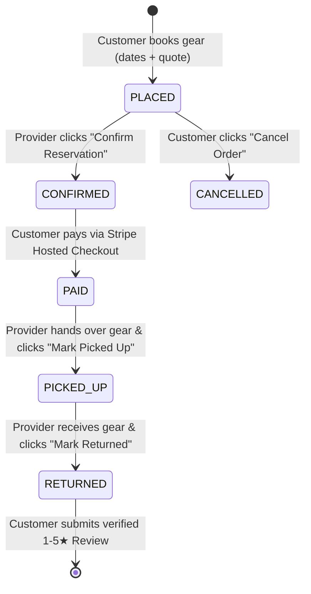
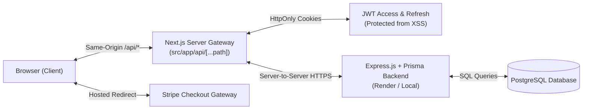

# 🏋️ GearUp — Rent Sports & Outdoor Gear Instantly

[](https://nextjs.org/)
[](https://react.dev/)
[](https://www.typescriptlang.org/)
[](https://tailwindcss.com/)
[](https://stripe.com/)
[](https://vercel.com/)

> **GearUp** is a high-performance, modern sports and outdoor equipment rental web application built with **Next.js 16 App Router**, **React 19**, **TypeScript**, and **Tailwind CSS**. It connects outdoor enthusiasts with verified local equipment providers, facilitating hassle-free rental bookings, real-time status tracking, and secure payment processing.

---

## 📌 Project Submission & Live Links

| Resource | URL / Details |
| :--- | :--- |
| **Live Frontend (Vercel)** | [https://gearup-frontend-three-coral.vercel.app](https://gearup-frontend-three-coral.vercel.app) |
| **Backend API (Render)** | [https://gearup-backend-q7w4.onrender.com](https://gearup-backend-q7w4.onrender.com) |
| **Frontend GitHub Repo** | [https://github.com/ahnafabid10/gearup-frontend](https://github.com/ahnafabid10/gearup-frontend) |
| **Backend GitHub Repo** | [https://github.com/ahnafabid10/GearUp-backend](https://github.com/ahnafabid10/GearUp-backend) |
| **API Integration Doc** | [`API_INTEGRATION.md`](./API_INTEGRATION.md) |

---

## 🔐 Demo & Testing Credentials

The platform is pre-seeded with tested role accounts for evaluation:

| Role | Email Address | Password | Permissions & Scope |
| :--- | :--- | :--- | :--- |
| 🛡️ **Platform Admin** | `admin@rentnest.com` | `admin123` | Full user suspension/activation, category CRUD & approval, platform metrics, moderation |
| 🏪 **Equipment Provider**| `abidprovider@gmail.com` | `123456789` | Active provider with 5+ premium outdoor listings, bookings & inventory CRUD |
| 🏪 **Demo Provider** | `provider@gearup.com` | `password123` | Secondary test provider account |
| 🧗 **Customer (Renter)** | `customer@gearup.com` | `password123` | Browse gear, request rentals, pay via Stripe Checkout, leave verified reviews |

> 💡 *New users can also register as either a **Customer** or a **Provider** directly via the registration form.*

---

## 🌟 Key Features

### 1. 🌐 Public Features
- **Editorial Hero & Modern Landing Page:** Visual outdoor storytelling, curated activity highlights, and how-it-works section.
- **Dynamic Gear Catalog (`/gear`):** Optimized equipment grid rendering with `next/image`, responsive layout, and real-time counter.
- **Advanced Search & Filtering:**
  - Real-time keyword search across title, description, and brand.
  - Category selector with slug and ID resolution.
  - Brand filter and Min/Max daily rate price constraints.
  - In-stock availability toggle and real-time filter reset.
- **Interactive Gear Details (`/gear/[id]`):**
  - High-resolution interactive image gallery with thumbnail preview.
  - Detailed equipment specifications, provider profile, and verified customer reviews.
  - Interactive "Rent Now" quote calculator with native date pickers, preventing past date selection and automatically calculating rental duration, subtotal, and security deposits.
- **Resilient UI States:** Skeleton loaders (`loading.tsx`), empty states, and graceful error boundary fallbacks (`error.tsx`).

### 2. 🧗 Customer Workspace (`/dashboard/customer`)
- **Rental History Table:** Track all gear bookings with real-time lifecycle status badges.
- **Hosted Stripe Checkout:** Single-click redirect to Stripe Hosted Checkout Sessions (`/api/payments/checkout-session`) with 256-bit SSL encryption.
- **Payment Outcome Verification:** Dedicated `/payment/success` and `/payment/cancel` pages with automatic backend session verification and immediate state synchronization.
- **Settled Transactions:** Audit log of completed Stripe payments with transaction IDs and timestamps.
- **Verified Product Reviews:** Interactive review form (1-5 star rating + feedback) unlocked once equipment is safely marked as returned.
- **Order Cancellation:** Customers can cancel reservations while in `PLACED` status with instant stock recovery.

### 3. 🏪 Provider Command Center (`/dashboard/provider`)
- **Business Performance Metrics:** Real-time counters for total listed inventory, active outgoing rentals, pending bookings, and total rental revenue.
- **Inventory CRUD Management:**
  - Add new gear (`/dashboard/provider/gear/new`) with multi-image HTTPS URLs, pricing, deposit, specifications, and total inventory stock.
  - Edit existing listings (`/dashboard/provider/gear/[id]/edit`) and instantly toggle item availability.
  - Permanent deletion protection.
- **Incoming Bookings Management:** Dedicated table to process rental orders through their complete lifecycle:
  - `PLACED` ➔ Click **"Confirm Reservation"**
  - `PAID` ➔ Click **"Mark Picked Up"**
  - `PICKED_UP` ➔ Click **"Mark Returned"** (restoring stock and unlocking customer reviews)
- **Category Suggestions:** Submit new category proposals to platform admins and monitor approval statuses.

### 4. 🛡️ Admin Platform Moderation (`/dashboard/admin`)
- **Global Platform Analytics:** Aggregated statistics covering total registered members, active catalog listings, total bookings, and gross platform volume.
- **Member Directory & Account Moderation:** Paginated data table of all users with search, role badges, product/booking tallies, and one-click **"Suspend Account"** / **"Activate Account"** actions.
- **Global Content Moderation:** Direct inspection of all equipment listings and rental contracts across the entire platform.
- **Complete Category Management (`/dashboard/admin/categories`):** Create new categories, rename, toggle active/inactive status, delete unused categories, and approve/reject provider category submissions with reviewer notes.

---

## 🔄 Rental Order Lifecycle



### UI Status Badge System:
- <kbd style="background:#fff0cf;color:#96621d;padding:2px 8px;border-radius:4px;font-weight:bold;">PLACED</kbd> Amber/Yellow — Reservation placed; awaiting provider confirmation.
- <kbd style="background:#e3efff;color:#315b96;padding:2px 8px;border-radius:4px;font-weight:bold;">CONFIRMED</kbd> Blue — Confirmed; customer sees "Pay with Stripe 💳" button.
- <kbd style="background:#efe4fb;color:#7646a0;padding:2px 8px;border-radius:4px;font-weight:bold;">PAID</kbd> Purple — Stripe transaction verified; provider sees "Mark Picked Up" button.
- <kbd style="background:#e6f1d7;color:#4e712a;padding:2px 8px;border-radius:4px;font-weight:bold;">PICKED_UP</kbd> Green — Customer in possession of equipment.
- <kbd style="background:#edf0eb;color:#606b60;padding:2px 8px;border-radius:4px;font-weight:bold;">RETURNED</kbd> Gray — Equipment returned and verified; customer sees "Leave Review" button.
- <kbd style="background:#fce9e6;color:#9d493e;padding:2px 8px;border-radius:4px;font-weight:bold;">CANCELLED</kbd> Red — Reservation terminated; inventory restored.

---

## 🏛️ System Architecture & Security Highlights



1. **Next.js 16 Proxy Architecture (`src/proxy.ts`):**
   - Utilizes Next.js 16's official `proxy.ts` convention for edge-level route protection on all `/dashboard/:path*` routes.
2. **Backend-For-Frontend (BFF) Gateway (`src/app/api/[...path]/route.ts`):**
   - All client network calls query the same-origin `/api/...` proxy.
   - Access and refresh tokens are intercepted and stored in **`HttpOnly`**, **`Secure`**, **`SameSite=Lax`** cookies, preventing malicious client script access (XSS mitigation).
   - Strict Origin verification for mutating requests (`POST`, `PUT`, `PATCH`, `DELETE`) shields against CSRF.
   - Built-in 45-second timeout resilience to gracefully absorb Render free-tier cold starts.
3. **Server-Side Role Guard Layout (`src/app/dashboard/[role]/layout.tsx`):**
   - The root dashboard layout validates the user's live profile against `/api/auth/me` on the server before rendering, redirecting unauthorized attempts immediately.

---

## 🗺️ Routes & Backend API Consumption

| Next.js Route | Feature / View | Backend Endpoint Consumed | HTTP Method |
| :--- | :--- | :--- | :--- |
| `/` | Landing page & featured gear | `/api/gear?limit=4`, `/api/categories` | `GET` |
| `/gear` | Catalog with search & filter | `/api/gear`, `/api/categories` | `GET` |
| `/gear/[id]` | Details & rental request | `/api/gear/:id`, `/api/rentals` | `GET`, `POST` |
| `/auth/register` | User onboarding | `/api/auth/register` | `POST` |
| `/auth/login` | Authentication | `/api/auth/login`, `/api/auth/me` | `POST`, `GET` |
| `/dashboard/customer` | Customer bookings & payments | `/api/rentals`, `/api/payments` | `GET` |
| `/dashboard/customer/orders/[id]/pay` | Payment initiation | `/api/rentals/:id`, `/api/payments/checkout-session` | `GET`, `POST` |
| `/payment/success` | Payment verification | `/api/payments/verify-session`, `/api/rentals/:id` | `POST`, `GET` |
| `/payment/cancel` | Cancelled payment notice | `/api/rentals/:id` | `GET` |
| `/dashboard/provider` | Provider inventory & bookings | `/api/provider/gear/my`, `/api/provider/orders` | `GET` |
| `/dashboard/provider/gear/new` | Add new equipment listing | `/api/categories`, `/api/provider/gear` | `GET`, `POST` |
| `/dashboard/provider/gear/[id]/edit` | Edit equipment listing | `/api/gear/:id`, `/api/provider/gear/:id` | `GET`, `PUT` |
| `/dashboard/provider/orders` | Manage incoming rentals | `/api/provider/orders`, `/api/provider/orders/:id` | `GET`, `PATCH` |
| `/dashboard/admin` | Global analytics & user control | `/api/admin/users`, `/api/admin/users/:id`, `/api/admin/gear`, `/api/admin/rentals` | `GET`, `PATCH` |
| `/dashboard/[role]/categories` | Category management | `/api/categories`, `/api/categories/manage`, `/api/categories/suggestions` | `GET`, `POST`, `PATCH`, `DELETE` |
| `/dashboard/[role]` (Profile) | User profile settings | `/api/users/profile` | `GET`, `PATCH` |

*For full request/response payloads, headers, and component mapping, see [`API_INTEGRATION.md`](./API_INTEGRATION.md).*

---

## 💻 Tech Stack

| Technology | Purpose | Version |
| :--- | :--- | :--- |
| **Next.js** | React Framework (App Router, Server Components, API Gateway) | `16.4.6` |
| **React** | Component UI Library | `19.3.0` |
| **TypeScript** | Type Safety & Interface Definitions | `^5.0.0` |
| **Tailwind CSS** | Utility-First Styling & Custom Design Tokens | `4.3.3` |
| **React Icons** | UI iconography | `^5.7.0` |
| **ESLint & Prettier** | Code Quality & Formatting | `^9.0.0` / `^3.10.1` |
| **Vercel** | Edge Deployment & Serverless Functions | Production |

---

## ⚙️ Environment Variables

Create a `.env.local` file in the root of `gearup-frontend`:

```env
# Application Port
PORT=3030
NEXT_PUBLIC_APP_URL="http://localhost:3030"

# GearUp Backend Base API URL (without trailing /api)
# For local development:
GEARUP_API_URL="http://localhost:5000"
NEXT_PUBLIC_GEARUP_API_URL="http://localhost:5000"

# For production (Vercel):
# GEARUP_API_URL="https://gearup-backend-q7w4.onrender.com"
# NEXT_PUBLIC_GEARUP_API_URL="https://gearup-backend-q7w4.onrender.com"
```

---

## 🚀 Local Development Setup

### Prerequisites
- Node.js `v20.x` or later
- npm or yarn
- Running instance of the GearUp Backend API (default `http://localhost:5000`)

### Steps
1. **Clone the repository:**
   ```bash
   git clone https://github.com/ahnafabid10/gearup-frontend.git
   cd gearup-frontend
   ```
2. **Install dependencies:**
   ```bash
   npm install
   ```
3. **Configure environment:**
   ```bash
   cp .env.example .env.local
   ```
4. **Run development server:**
   ```bash
   npm run dev
   ```
   Open [http://localhost:3030](http://localhost:3030) in your browser.

5. **Run type-check & linting:**
   ```bash
   npx tsc --noEmit
   npm run lint
   ```
6. **Build for production:**
   ```bash
   npm run build
   npm run start
   ```

---

## 🛡️ Error Handling & UI Feedback
- **Global Toast Engine:** Every mutating action (`POST`, `PUT`, `PATCH`, `DELETE`) automatically triggers reactive toast notifications via standard DOM CustomEvents, guaranteeing instant user feedback.
- **Graceful Error Boundaries (`error.tsx`):** Uncaught runtime or rendering errors are intercepted with an interactive "Try again" fallback.
- **Route Not Found (`not-found.tsx`):** Custom 404 page for missing gear items or invalid routes.
- **DataState Container:** Reusable state wrapper handling loading skeletons, error banners, and empty search states across all catalog and dashboard lists.